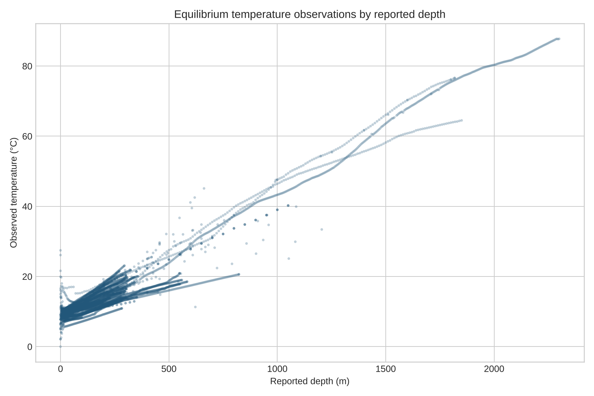
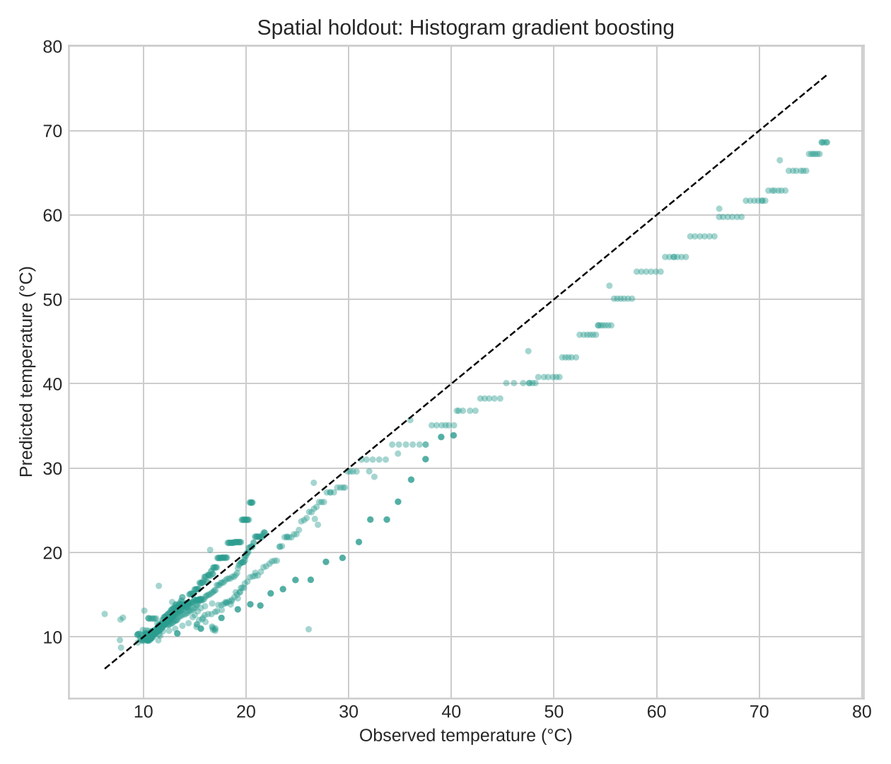
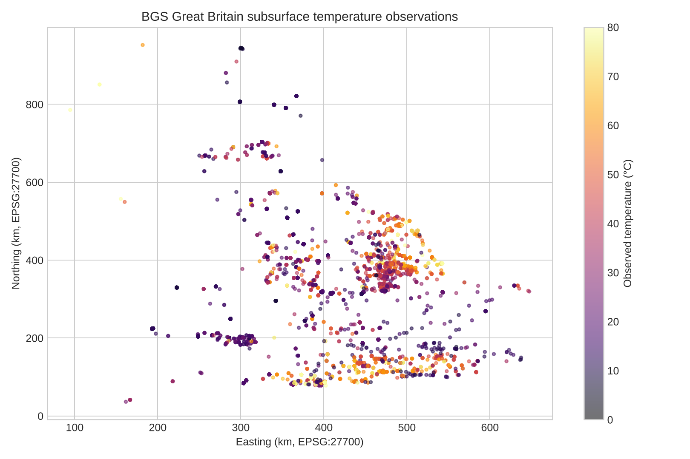

# Predicting Subsurface Temperature in Great Britain with Machine Learning

How well can measured subsurface temperature be predicted from depth, location and site context, when whole regions are held out from training? This project builds and evaluates temperature models on the **British Geological Survey (BGS) UK Digital Geothermal Catalogue v2** as a first step towards data-driven geothermal screening.



## Key results

Evaluated on **771 equilibrium temperature measurements from 19 boreholes in 12 spatial blocks (50 km × 50 km)** that the models never saw during training:

| Model | MAE (°C) | RMSE (°C) | R² |
|---|---:|---:|---:|
| **Histogram gradient boosting** | **2.64** | **3.89** | **0.945** |
| Random forest | 3.14 | 4.33 | 0.932 |
| Linear geothermal gradient (depth only, ≈35 °C/km) | 3.70 | 4.99 | 0.910 |
| Median baseline | 10.91 | 19.25 | −0.338 |

- Depth alone explains most of the variance: a simple linear gradient already reaches R² = 0.91.
- Gradient boosting **reduces the error by about 29% relative to that physical baseline** (MAE 3.70 → 2.64 °C) by learning regional structure from location and site context.
- Coverage is very uneven. The Cornwall area, the UK's main deep-geothermal target, has only 13 records from 6 sites. That is too few for a regional model, so Cornwall is treated as a coverage-limited case study.

## Data

| Item | Value |
|---|---|
| Source | [BGS UK Digital Geothermal Catalogue v2](https://doi.org/10.5285/9c324699-abf1-4412-ab9f-39308507082d) |
| Cleaned GB temperature records | 8,900 from 1,731 sites (0–10,504 m depth) |
| Modelling subset (equilibrium measurements only) | 5,367 records from 108 sites |
| Heat-flow records (context only, not modelled) | 131 sites |
| Coordinate system | British National Grid (EPSG:27700) |

Only **equilibrium** temperature types are modelled (equilibrium logs, open-hole equilibrium logs, equilibrium measurements). Bottom-hole and drilling/test temperatures are excluded because they are affected by drilling disturbance and are not directly comparable.

## Method

1. **Cleaning.** The script removes the units row embedded in each BGS sheet, converts `-9999` and text placeholders (`Not Entered`, `?`) to missing values, and applies range checks.
2. **Features.** The models use depth, easting, northing, estimated mean annual ground temperature, ground level, reference elevation and drilled length. Site IDs, corrected temperatures, gradients, conductivity and heat flow are **excluded to prevent target leakage**.
3. **Spatial validation.** Every record is assigned to a 50 km British National Grid block, and whole blocks go to train or test (`GroupShuffleSplit`, 80/20). This tests transfer to unseen areas, which is stricter than a random row split.
4. **Models.** Two baselines (median, and linear depth-only gradient) are compared with a random forest and a histogram gradient boosting model. Missing values are median-imputed using training data only.

<p align="center">
  
  
</p>

## Limitations

- The catalogue mixes instruments, decades and depth datums. Spatial blocking reduces leakage but cannot remove **selection bias** in where boreholes were drilled.
- Neighbouring blocks are not fully independent, and the test set only covers areas that already have data.
- The model predicts **temperature at measured points**. It does not estimate recoverable heat, power output or site feasibility.
- The Cornwall window is an approximate rectangle, not an official boundary.

**Next steps:** add geological and hydrogeological covariates (e.g. BGS bedrock geology, granite proximity), use an official Cornwall boundary, and quantify prediction uncertainty (e.g. quantile gradient boosting).

## Repository structure

```
├── src/analyze.py            # full pipeline: cleaning → modelling → figures
├── notebooks/                # notebook wrapper that runs the pipeline
├── outputs/
│   ├── figures/              # figures used above
│   └── metrics/              # model metrics, holdout predictions, summary JSON
└── data/
    ├── README.md             # how to download the BGS data
    └── raw/                  # (not tracked) BGS catalogue goes here
```

## Reproduce

```bash
git clone https://github.com/JiaxiMao/gb-geothermal-temperature-ml.git
cd gb-geothermal-temperature-ml
pip install -r requirements.txt
# download the BGS catalogue into data/raw/ (see data/README.md)
python src/analyze.py
```

The run takes under 10 seconds, and all random seeds are fixed (`random_state=42`).

## Tools

Python · pandas · scikit-learn · matplotlib

## Acknowledgement

Data from the British Geological Survey, *UK Digital Geothermal Catalogue v2*, DOI [10.5285/9c324699-abf1-4412-ab9f-39308507082d](https://doi.org/10.5285/9c324699-abf1-4412-ab9f-39308507082d). Contains data supplied by UKRI. Raw data are not redistributed here; please obtain them from the source and follow its licence terms.
